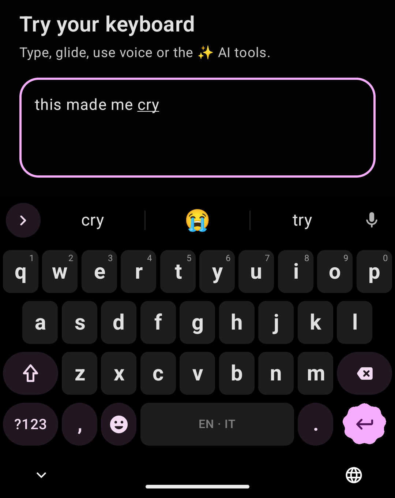
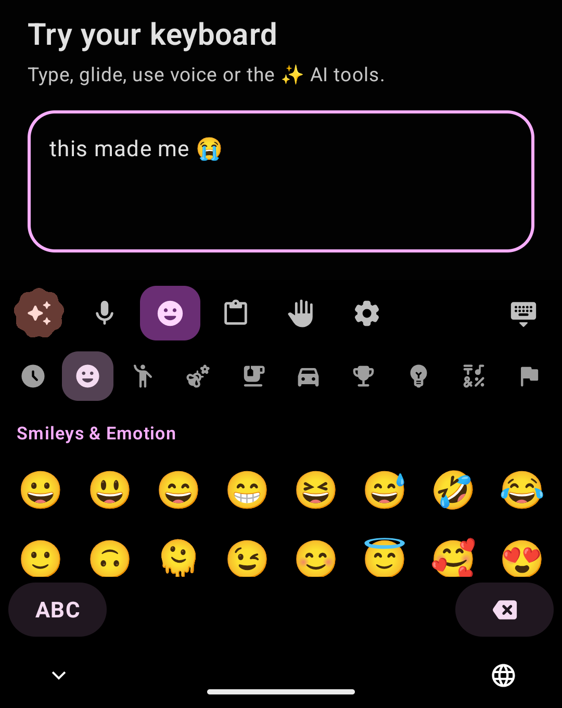
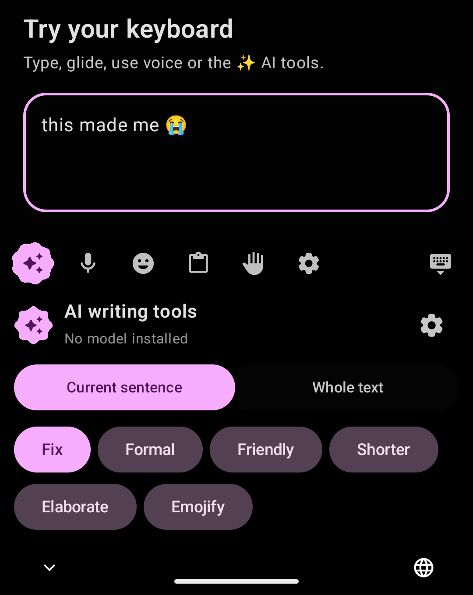
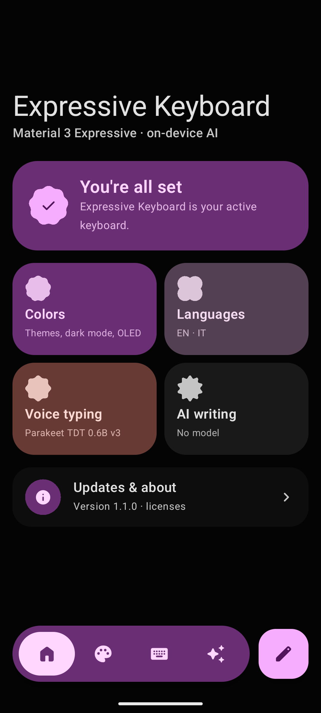
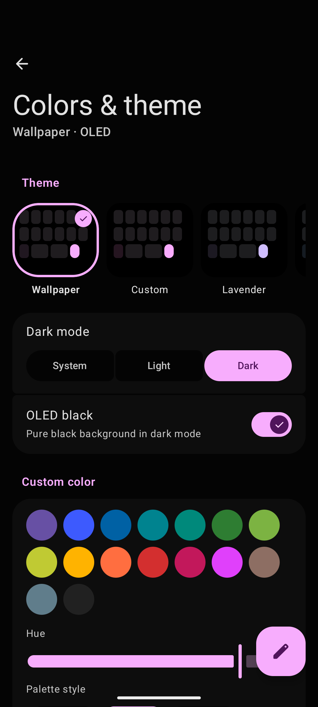
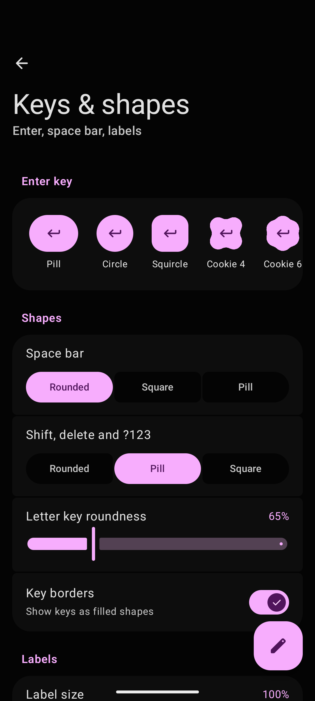
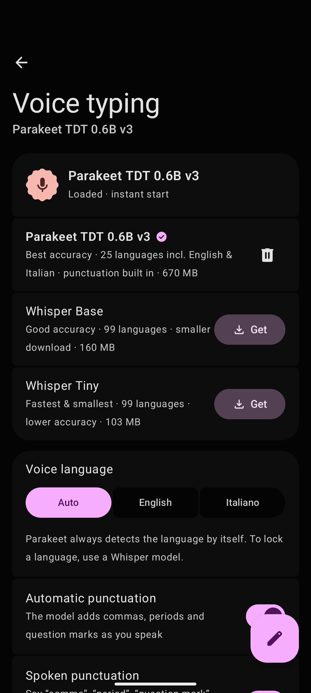

# Expressive Keyboard

<div align="center">
  <b>A fully local, privacy-first Android keyboard that's actually nice to use.</b>
  <br>
  Material 3 Expressive design, glide typing, multilingual autocorrect, AI rewrites and voice typing, all running on your phone. Nothing you type or say ever leaves it.
  <br><br>
  <a href="https://github.com/visiuun/expressive-keyboard/releases/latest/download/ExpressiveKeyboard.apk">
    
  </a>
  <br><br>
  
  
  
  
</div>

<br>

<p align="center">
  
  
  
</p>

<p align="center">
  
  
  
  
</p>

## At a glance

```text
Problem    The polished keyboards send what you type and say to the cloud for their "smart" features.
           The private ones keep your data local, but they look dated, feel clunky and drop the
           features you'd miss: glide typing, good autocorrect, voice typing, AI, emoji suggestions.

Keyboard   Fully local and privacy-focused, with a modern Material 3 Expressive design and all of
           those features. AI and voice models run on your phone, the keyboard has no analytics,
           no ads and no account, and it handles two languages in one sentence.

Setup      1. Install ExpressiveKeyboard.apk and open it.
           2. Tap "Enable in system settings", then "Switch to Expressive Keyboard".
           Done. Start typing anywhere. Optional: download a voice model and an AI model in settings.
```

**Examples**

| You type or do | You get |
| --- | --- |
| `cry` | `cry` · **😭** · `try` in the strip. Tap 😭 and it replaces the word |
| `lol`, `fire`, `thanks`, `love` | 😂, 🔥, 🙏, ❤️ in the middle of the strip |
| `teh ` (with a space) | `the`. Press backspace right away to undo the correction |
| `perche` with Italian on | `perché` (missing accents are fixed) |
| `l'amico`, `dell'acqua` | Kept as written. Elisions in Italian and French are understood |
| A word in English, then one in Italian | Neither is "corrected": a word valid in any active language is left alone |
| Swipe across the letters | Glide typing with a trail and alternatives in the strip |
| Drag on the space bar | Moves the cursor |
| Swipe left on backspace | Selects whole words to delete, release to delete them |
| Long-press a suggestion | Blocks it from ever showing again |
| ✨ → **Fix** on a sentence | Grammar, spelling and accents fixed by a local AI model, undoable |
| ✨ → **Formal** / **Friendly** / **Shorter** | The sentence or whole text rewritten in that tone |
| 🎤 and talk | Live text as you speak, punctuation added, final text when you pause |
| Say "comma", "new line", "virgola", "a capo" | `,` and line breaks, in six languages |
| Copy an image | It shows up in the clipboard panel and can be pasted into chat apps |

## Install

1. Download [`ExpressiveKeyboard.apk`](https://github.com/visiuun/expressive-keyboard/releases/latest/download/ExpressiveKeyboard.apk) on your phone and open it. Allow "install unknown apps" for your browser or file manager if Android asks.
2. Open **Expressive Keyboard** and follow the two setup steps: enable it, then switch to it.
3. Optional:
   - **Voice typing:** AI & Voice → Voice typing → **Get** a model (Parakeet TDT 0.6B v3 is the most accurate).
   - **AI writing:** AI & Voice → AI writing → **Get** a model (Qwen3.5 0.8B is the recommended one).

The release page also has smaller APKs for each CPU type (`ExpressiveKeyboard-arm64-v8a.apk` for almost every modern phone). The universal `ExpressiveKeyboard.apk` works everywhere.

### Updates

The app checks GitHub releases once a day and on every launch of its settings. When a new version is out you get a notification (if you allow it) and an **Update available** card on the home screen. Tap **Update now**: it downloads the APK built for your phone's CPU and hands it to Android's installer. Turn this off under **Updates & about**.

## Using it

### Suggestions and autocorrect

The strip above the keys shows three choices. When the keyboard is about to correct a word, the correction sits in the middle and is applied when you press space or punctuation. Your literal word is on the left. Press backspace straight after a correction to undo it.

Corrections use a typo model that knows which keys are next to each other, plus the previous word for context. When you have nothing typed, the strip predicts the next word. The keyboard learns new words you use and word pairs you type often. All of this is stored only on your phone.

### Emoji

Type a word and a matching emoji appears in the middle of the strip, the way you'd expect from a stock keyboard. About a hundred common words have a hand-picked emoji (`cry` → 😭, `lol` → 😂, `dead` → 💀). Others are found by emoji name, including inflections (`laugh` → `laughing`). Tapping the emoji replaces the word.

The emoji panel has categories, recents and skin tones (long-press an emoji).

### Languages

Turn on up to three of English, Italiano, Español, Français, Deutsch and Português under **Languages**. Suggestions, autocorrect, glide typing and predictions merge every active language. Each one is weighted by how much you use it and by the language of the sentence you're typing. A word that's valid in any active language is never autocorrected.

### Voice typing

Fully offline, powered by [sherpa-onnx](https://github.com/k2-fsa/sherpa-onnx). Choose a model:

| Model | Size | Notes |
| --- | --- | --- |
| Parakeet TDT 0.6B v3 | 670 MB | Best accuracy, 25 languages, punctuation built in |
| Whisper Base | 160 MB | Good accuracy, 99 languages, can lock a language |
| Whisper Tiny | 103 MB | Fastest, lower accuracy |

Text appears live while you speak and is finalized when you pause. Automatic punctuation and spoken punctuation ("comma", "period", "question mark", "new line", or "virgola", "punto", "a capo" and their Spanish, French, German and Portuguese equivalents) can each be turned off.

### AI writing

Runs a small language model on your phone with Google's [LiteRT-LM](https://github.com/google-ai-edge/LiteRT-LM). Nothing is sent anywhere.

| Model | Size | Notes |
| --- | --- | --- |
| Qwen3.5 0.8B | 964 MB | Recommended, corrects reliably in all six languages |
| LFM2.5 350M | 247 MB | Tiny and fast, too small for reliable grammar fixes |
| Gemma 4 E2B | 2.6 GB | Best quality, 140 languages, needs 8 GB+ RAM |

You can also import any `.litertlm` model file.

- **✨ panel:** Fix, Formal, Friendly, Shorter, Elaborate and Emojify, on the current sentence, your selection or the whole text. Every change can be undone.
- **Sentence-level correction** (opt-in): when you end a sentence with `.`, `!` or `?`, the AI checks the whole sentence and offers a fix in the strip, or applies it automatically if you choose.
- **AI next-word prediction** (opt-in).
- A faithfulness check rejects answers that don't match what you wrote, so a small model can't swap your text for something unrelated.

AI writing needs a 64-bit phone, because LiteRT-LM has no 32-bit build. Everything else works on 32-bit phones too.

### Clipboard

History with pinning, including images. Images are inserted through Android's rich-content API into apps that accept them (most chat apps). In other apps they're put on the system clipboard so a normal long-press paste works. A screenshot you took moments ago is offered as a chip in the strip.

### Look and feel

- 15 themes, including **Wallpaper** (Material You) and **Custom** (any color, eight palette styles).
- Light, dark or system, plus **OLED black**.
- 24 Material 3 Expressive shapes for the Enter key. Rounded, pill or square space bar and function keys. Adjustable key roundness, label size, bold labels and key borders.
- QWERTY, QWERTZ, AZERTY, Dvorak and Colemak. Optional number row, adjustable height, one-handed mode.
- Spring animations, key pop-ups and accent grids on long-press, with optional sound and adjustable vibration.

## Privacy

Expressive Keyboard is fully local. Typing, autocorrect, predictions, learned words, clipboard history, voice typing and AI writing all run and stay on your phone. There are no cloud features to opt out of, because there are none. The app connects to the internet only to:

- download the voice and AI models you choose (from Hugging Face), and
- check GitHub for app updates (you can turn this off).

It has no analytics, no ads and no account.

## Compatibility

- **Android 8.0 (API 26) and newer.**
- **CPU:** arm64-v8a, armeabi-v7a, x86_64 and x86 (emulators, Chromebooks). On 32-bit devices everything except AI writing works.
- Works with gesture navigation and 3-button navigation, and keeps clear of the system "hide keyboard" bar on Android 13+.
- With a hardware keyboard attached, the on-screen keyboard shows if "Show virtual keyboard" is on in Android's settings.

## Build from source

```powershell
git clone https://github.com/visiuun/expressive-keyboard
cd expressive-keyboard
.\setup.ps1              # Windows
```

```bash
git clone https://github.com/visiuun/expressive-keyboard
cd expressive-keyboard
./setup.sh               # Linux / macOS
```

The setup script installs everything the build needs and then builds the APKs into `app/build/outputs/apk/debug/`. If you have no JDK 17+, it downloads JDK 21 (Temurin) into `.tools/`. If you have no Android SDK, it downloads the command-line tools into `.tools/`. Either way it accepts the SDK licenses and writes `local.properties`, and Gradle downloads the platform, build tools and every library on first build. Use `--release` / `-Release` for release APKs, or `--no-build` / `-NoBuild` to only set up the toolchain. Opening the folder in Android Studio works too.

Every push is built by [GitHub Actions](.github/workflows/build.yml) using `setup.sh`.

### Signing and releases

Release APKs are signed with the key described in `keystore.properties`, which isn't in this repository:

```properties
storeFile=keystore/release.jks
storePassword=...
keyAlias=...
keyPassword=...
```

Without it, release builds are signed with the debug key. They install fine, but they can't update the official APKs (Android requires the same signature). `tools\release.ps1` builds signed APKs, names them for the in-app updater and publishes a GitHub release with the [GitHub CLI](https://cli.github.com).

### Project layout

```text
app/src/main/java/com/vis/expressivekeyboard/
  keyboard/   input method service, key handling, suggestions strip logic, layouts
  engine/     dictionaries, multi-language model, gesture decoder, emoji search, learned words
  ai/         LiteRT-LM engine, prompts, model downloads, output checks
  voice/      sherpa-onnx recognizer, VAD, spoken punctuation
  ui/         Compose keyboard, panels, themes, shapes
  settings/   settings app
  update/     GitHub release checker and installer
app/src/main/assets/   word lists, word-pair tables, emoji data, Silero VAD
tools/                 asset builders, icon fetcher, release script
```

Word lists and word-pair tables are generated with `tools/build_assets.py` (English) and `tools/build_lang.py` (other languages) from the sources listed at the top of each script.

## License

**[CC BY-NC 4.0](LICENSE)**. You're free to use, share, modify and build on Expressive Keyboard, as long as you:

- **credit** Visiuun and link back to this repository, and
- **don't use it commercially** (no selling it, bundling it in paid products, or using it for paid services).

For commercial licensing, open an issue. Third-party parts keep their own licenses (see Credits).

## Credits

Created by [Visiuun](https://github.com/visiuun).

- Word frequencies from [hermitdave/FrequencyWords](https://github.com/hermitdave/FrequencyWords) (OpenSubtitles 2018, CC BY-SA 4.0). Word pairs from [Tatoeba](https://tatoeba.org) (CC BY 2.0 FR). English word list from [dwyl/english-words](https://github.com/dwyl/english-words) (Unlicense). The generated assets in `app/src/main/assets` keep these licenses.
- Emoji data from the [Unicode emoji test file](https://unicode.org/Public/emoji/).
- Voice typing by [sherpa-onnx](https://github.com/k2-fsa/sherpa-onnx) (Apache-2.0) with [Silero VAD](https://github.com/snakers4/silero-vad) (MIT). Models: NVIDIA Parakeet TDT 0.6B v3 (CC BY 4.0) and OpenAI Whisper (MIT), downloaded on demand.
- AI writing by Google [LiteRT-LM](https://github.com/google-ai-edge/LiteRT-LM) (Apache-2.0). Models: Qwen3.5 (Apache-2.0), Gemma 4 (Apache-2.0), LFM2.5 (LFM Open License), downloaded on demand from [litert-community](https://huggingface.co/litert-community).
- Icons: [Material Symbols](https://fonts.google.com/icons) (Apache-2.0). UI: Jetpack Compose and Material 3 Expressive, colors by [MaterialKolor](https://github.com/jordond/MaterialKolor).
